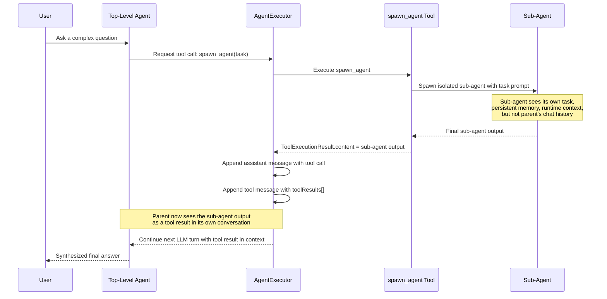

# Sub-Agent Context Merge

## Purpose

This document explains how sub-agent responses are exposed to the top-level agent in the current multi-agent runtime.

The short version:

- Sub-agents run in isolated context
- Their full internal message history is not copied into the parent
- Their final output is returned as the result of the `spawn_agent` tool
- The parent sees that result as a normal `tool` message on the next turn

## Core Rule

Sub-agents do not inherit the parent's conversation history, and the parent does not inherit the sub-agent's internal conversation transcript.

Instead, the parent only receives the sub-agent's returned output string.

## Sequence Diagram



## Message-Level View

After a `spawn_agent` call, the parent conversation is extended like this:

```text
assistant:
  content: "I'll delegate this."
  toolCalls:
    - name: "spawn_agent"
      arguments: { agent_type: "explore", task: "..." }

tool:
  toolResults:
    - toolCallId: "..."
      content: "Sub-agent final answer here"
```

That `tool` message is what the parent model sees on the next turn.

## ASCII Flow

```text
Top-level agent
   |
   | calls spawn_agent(...)
   v
spawn_agent tool
   |
   | runs sub-agent to completion
   v
sub-agent
   |
   | returns final text
   v
spawn_agent tool result
   |
   | content = "sub-agent final answer"
   v
parent executor appends:
  1. assistant message with tool call
  2. tool message with toolResults[]
   |
   v
next top-level LLM turn reads tool message
   |
   v
top-level agent synthesizes final answer
```

## What Is Preserved

- The sub-agent's final returned text
- The sub-agent type and turn count as tool metadata
- Partial output if the sub-agent fails or times out and the tool can recover something useful

## What Is Not Preserved

- The sub-agent's full message history
- The sub-agent's hidden intermediate reasoning
- The sub-agent's tool-by-tool transcript as structured parent context

Those details may still appear in UI activity events, but they are not merged into the parent's LLM message history as full conversation state.

## Relevant Implementation Points

### 1. Parent spawns sub-agent with isolated context

`AgentManager.spawn()` clears inherited conversation history for sub-agents and marks them as isolated:

- `conversationHistory: undefined`
- `isolatedContext: true`

Source:

- `packages/core/src/agents/multi-agent/agent-manager.ts`

### 2. spawn_agent returns the sub-agent's final content

The `spawn_agent` tool executes the sub-agent and returns:

- `content: result.content || "(no output from sub-agent)"`

If the sub-agent fails, the tool may return an error plus partial output.

Source:

- `packages/core/src/tools/builtin/spawn-agent.ts`

### 3. Executor merges tool results into the parent conversation

After tool execution, the executor appends:

1. an `assistant` message containing the tool call
2. a `tool` message containing `toolResults`

This is the actual merge point for sub-agent output into the parent context.

Source:

- `packages/core/src/agents/executor.ts`
- `packages/core/src/agents/types.ts`

## Practical Consequence

If a parent agent wants a sub-agent to know specific file paths, prior findings, or user preferences, it must include them explicitly in the spawned task prompt.

If a parent agent wants to use a sub-agent's work later, it relies on the sub-agent's returned summary, not on automatic transcript sharing.

## Current Design Intent

This design keeps sub-agents cheap and focused:

- less token bloat
- clearer task boundaries
- predictable delegation

The tradeoff is that prompt quality for `spawn_agent` matters a lot, because context does not flow automatically across agent boundaries.
