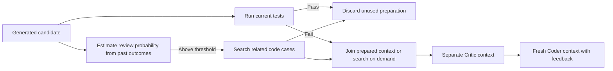

# Predicting the next review preparation task

This experimental path retrieves related Python debugging examples while a candidate's tests run. Its predicted future task is preparation of context for a possible Critic review. It does not predict a future answer or execute a speculative code correction.



## Code similarity

The retrieval index parses candidate code as data with Python `ast` and `tokenize`. It never executes candidate code for retrieval. Similarity combines cosine similarity of normalized token trigrams (60%) with AST node-type histograms (40%). Names, numbers, and strings are normalized so simple renaming does not dominate the score. If syntax is invalid, retrieval falls back to the available lexical features.

The index returns up to three cases with similarity at least 0.25. These scores express structural and lexical resemblance, not semantic relevance or correctness probability. Normalizing names loses API and identifier meaning, and node histograms lose ordering. A high score can therefore identify an irrelevant example. Critic input labels these cases as untrusted suggestions to check against the current evidence.

The default corpus contains eight generic debugging examples. It is not a collection of measured MBPP corrections. For real historical cases, supply a JSON array containing `id`, `code`, and `analysis`, with `sourceProblemId` recording the original benchmark problem ID. A known overlap with any evaluated problem is rejected. Missing or inaccurate source IDs cannot provide a leakage guarantee.

```json
[
  {
    "id": "historical-case-1",
    "sourceProblemId": "an-id-outside-the-evaluation-set",
    "code": "def average(items):\n    return sum(items) / len(items)",
    "analysis": "A previous empty-input failure required checking the task's empty-input contract. Verify whether that condition applies here."
  }
]
```

## Prediction and scheduling

The initial predictor is deliberately small: an online Beta-Bernoulli model with a Beta(1, 3) prior, separated into loop, branch, and plain-code buckets. It uses only the current candidate text and completed past test outcomes. It cannot see the current test outcome or a reference answer. The default probability threshold is 0.2. This is a baseline predictor, not a trained semantic task planner.

Three modes expose the scheduling comparison:

- `sequential`: search only after failed tests.
- `eager`: start a search for every candidate while tests run.
- `predictive`: search in advance only above the predicted-review threshold; search after failure if prediction missed.

There is at most one preparation alongside one active test execution. Completed searches for passing candidates are discarded. In-flight discarded searches are drained, and their elapsed cost is included. Optional retrieval errors are recorded separately and the Critic proceeds without those suggestions. Predictor state and corpus hash are saved in problem checkpoints; a changed corpus cannot be silently substituted on resume.

Both sequential and predictive modes search the same corpus with the same code and retrieval settings. Scheduling changes when the context is prepared, not which information is eligible for the Critic. Adding retrieved context can affect live LLM behavior, so accuracy must be measured separately from scheduling time.

## Use with live Critic evaluation

```bash
npm run build
npm run dev -- --eval --benchmark mbpp --model gemini-3.6-flash --agentic --limit 20 --review-preparation predictive --output predictive.json
npm run dev -- --eval --benchmark mbpp --model gemini-3.6-flash --agentic --limit 20 --review-preparation sequential --output sequential.json
```

Add `--review-cases path/to/cases.json` for a historical corpus and `--prediction-threshold 0.3` to adjust the threshold. Preparation mode requires fresh Critic evaluation, not `--baseline-report` or blind retries. These example commands make paid API requests; the local replay below does not call an LLM.

Each problem records prediction probability, decisions, adoption/discard counts, retrieval failures, tool duration, preparation duration, post-tool waiting, foreground duration, drained elapsed duration, and selected case IDs/scores. Preparation durations are wall time, not CPU usage. Live token totals include the actual Critic requests; retrieved text can increase input tokens.

## Isolate scheduling without new model samples

```bash
npm run build
npx tsx scripts/benchmark-review-preparation.ts --baseline docs/reports/mbpp-validated-single-100-2026-11-13.json --repeats 5 --output preparation.json
```

The script re-executes the saved candidates' real tests, rotates mode order, resets each predictor per run, and verifies unchanged test outcomes and identical retrieved review contexts. It uses no synthetic delays. It records the corpus, problem/test snapshot, baseline hash, and exact experiment source snapshots/hashes. Shared index initialization and dataset loading are reported separately from mode timing.

This replay measures test/retrieval scheduling only. It makes zero new LLM calls and cannot establish an accuracy improvement, token savings in live Critic calls, or end-to-end agent speedup. See the [initial five-repeat experiment](../reports/speculative-review-preparation-2026-11-14.md).
