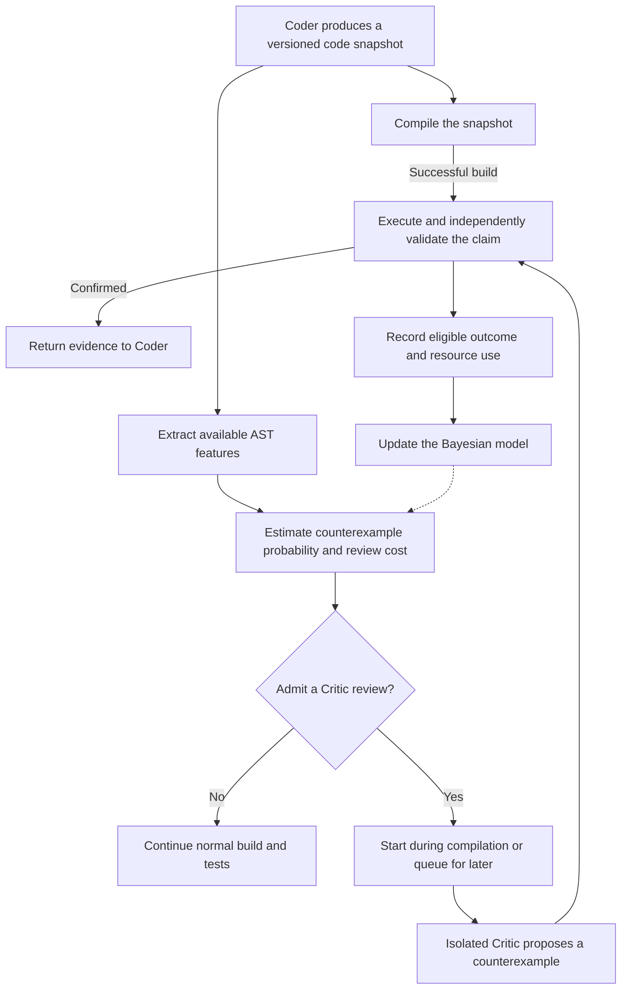

# AST Based Bayesian Critic Workflow

The proposed workflow uses static code features to estimate whether an isolated Critic will produce an independently verified counterexample within a fixed budget. That estimate informs whether to spend resources on a review. An admitted review may start during compilation to reduce the wait for confirmed feedback.

The research motivation is to help Coder identify incorrect algorithm choices or solution directions using executable evidence. The Critic receives the problem and code in a separate context and attempts to construct a counterexample. Similarity scoring and reference solution retrieval are not part of this workflow.

## Prediction target

Estimate `P(verified counterexample | AST features, problem context, Critic configuration, budget, observed data)`. Fix the problem regime, Critic model, instructions, and time and token budgets initially, or represent their differences explicitly. This is the probability of a particular review outcome, not a correctness certificate.

## Learning workflow

1. Collect code snapshots and extract an AST feature vector for each. Candidate features include source size, branch count, loop nesting, container types, recursion, index dimensions, and conditional deletion or overwrite sites. Preserve unknown complexity estimates as unknown. Record the problem, source hash, feature extraction time, and review configuration.
2. Obtain initial labels through a budgeted set of reviews before relying on the predictor to select reviews. Pair each snapshot's full feature vector with its independently checked Critic outcome. Do not reduce the data to global success and failure counts or manually selected groups.
3. Fit a Bayesian conditional probability model. A first candidate is logistic regression, `p(x) = sigmoid(b + w*x)`, with regularizing priors on the coefficients and a compact set of interactions if needed. Observations update the coefficient distribution according to how well each coefficient combination explains the feature and outcome pairs. Beta distributions are not required.
4. For a new feature vector, average its predicted success probability over the coefficient posterior. Retain uncertainty about that estimate. Train only on earlier eligible outcomes; the current snapshot's review result cannot be an input to its own admission decision.

| Observed outcome                                                                             | Training treatment                                                 |
| -------------------------------------------------------------------------------------------- | ------------------------------------------------------------------ |
| Independently verified counterexample within the configured budget                           | `y = 1`                                                            |
| Eligible review completes or exhausts its budget without a verified counterexample           | `y = 0`; this does not establish that the code is correct          |
| Review skipped                                                                               | Unlabeled                                                          |
| Build or infrastructure failure prevents evaluation, or a stale snapshot cannot be validated | Record separately; do not label as an unsuccessful eligible review |

## Execution workflow

1. **Freeze the input.** Coder finishes a snapshot. Start its build and extract the features available at that time. Account for both feature extraction and prediction overhead. Partial code prediction is a possible later extension, not an assumption of this workflow.
2. **Decide whether to review.** Combine the estimated discovery probability and its uncertainty with expected Critic and verification cost. Choose review or skip under an explicit resource budget or a value and cost rule with compatible units. A low-value review can be skipped entirely; compilation finishing does not automatically trigger it.
3. **Decide when to review.** For an admitted review, use remaining compilation time and resource availability to choose immediate execution or a later start. The Critic's resource use matters even when concurrent execution is available. Normal tests remain part of the build and validation path for both reviewed and skipped code.
4. **Generate evidence.** Give the Critic the problem and exact source snapshot in a separate context, without Coder's reasoning, a supplied answer, or a supplied counterexample. Ask for an input and the requirement or invariant the implementation allegedly violates. Separate context and guidance are design choices, not guarantees of independent reasoning.
5. **Verify the claim.** Once the matching artifact is available, execute the proposed input and check input validity and the claimed violation using an independent oracle or justified property. The Critic's claimed expected output is not ground truth. Bind the result to the reviewed source hash; compiler errors are handled separately.
6. **Return feedback and learn.** Send confirmed evidence to Coder for revision. Record eligible success or failure, Critic tokens and latency, verification cost, and the feature vector. Any revised code is a new snapshot. Skipped reviews remain unlabeled; budgeted audits can provide observations for cases the policy would otherwise never review. If later test failures trigger another review, record that different evidence regime separately.

## Status and SOP reference

This is a proposed, implementable workflow. The repository contains preliminary Critic experiments, compiled language timing measurements, and a scoped C++ AST extraction demonstration. The AST feature conditioned Bayesian model and the complete selective execution workflow have not been implemented and validated together. Numerical probability examples in the discussion use synthetic data.

For the SOP, the research progression is: Critic feedback requires additional resources; executable counterexamples provide a concrete feedback target; AST features and observed Critic outcomes could predict when that feedback is worth seeking; admitted reviews could overlap compilation; experiments would examine useful findings, missed findings, and total resource cost. The intended benefits remain research questions, not demonstrated savings. This outline supplies the research logic for the applicant's own wording.

The [conditional model specification](critic-conditional-probability-model-2026-11-21.md) defines the probability model in more detail. The [compiled language plan](critic-compile-overlap-plan-2026-11-21.md) records timing comparisons and evaluation considerations. No new implementation or experiment is introduced by this workflow summary.
